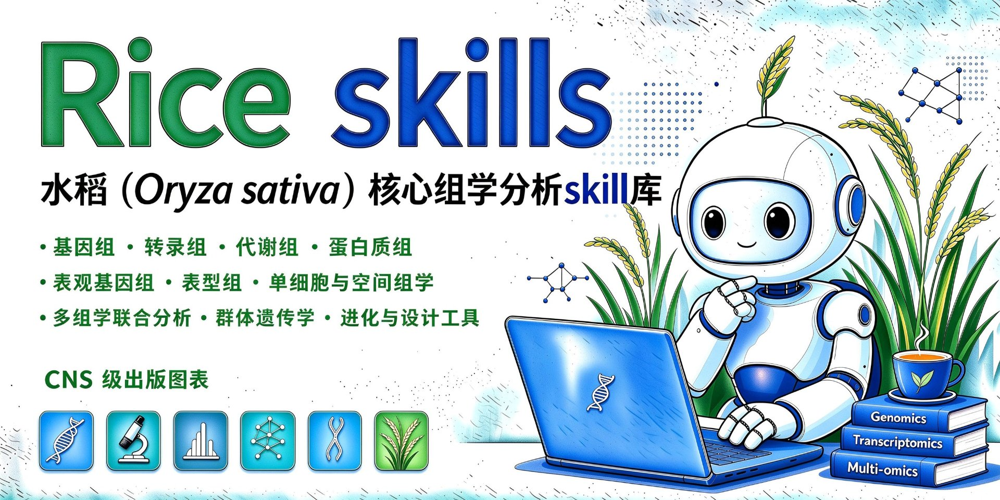

<div align="right">

[English](README.md) | **简体中文**

</div>

<div align="center">



<h1>Rice-skills</h1>

<h3>水稻（Oryza sativa）核心组学 + 育种分析技能包 + CNS 级绘图</h3>

<b>转录组 · 代谢组 · 联合分析 · GWAS · 群体遗传 · 泛基因组 · QTL ·<br>
蛋白组 · 表观组 · 表型组 · 单细胞 · 空间组学 · 进化 · CRISPR 设计</b>

<br>

[](LICENSE)
[](https://github.com/shuke-bio/Rice-skills/archive/refs/tags/v3.3.1.zip)


</div>

> 水稻（*Oryza sativa*）**全组学分析 Skill（v3.2）**：转录组 + 代谢组 + 联合分析 +
> **基因组学（变异检测/GWAS/群体遗传/泛基因组/eQTL/Meta-GWAS/单倍型/共定位/XP-EHH）** + **蛋白质组** + **表观基因组** +
> **表型组（BLUP/光谱/GBLUP/AMMI-GGE）** + **单细胞与空间组学** + **基因家族进化（KA/KS）与启动子 motif** +
> **引物与 CRISPR 靶点设计**，输出 CNS 级出版图表。
>
> **适用对象：任何从事水稻组学分析的研究者与团队。** 通用工具链——数据格式通用、参数全部可配、
> 不绑定任何实验室、平台或测序公司；仓库内所有示例数据均为**程序生成的演示数据**（性状名为占位符，可任意替换为你自己的数据）。
>
> 一个可打包上传 GitHub / OpenAI Skills 的完整科研软件包：**83 个 R/Python 脚本**
> （分析 + 工具；v3.2 新增 Bayesian 共定位/2D-GWAS/GRN 推断/miRNA 靶点/motif-TF 匹配/
> R/Python 双后端统一绘图规范，固定随机种子，全程可复现；每个模块配示例数据生成器与独立文档。

**English**: Rice-skills is a ready-to-publish, all-omics analysis skill for rice (Oryza sativa) —
transcriptomics, metabolomics and their integration, plus genomics (variants/GWAS/popgen/pangenome/eQTL),
proteomics, epigenomics, phenomics, single-cell and spatial omics, and primer/CRISPR design —
with CNS-grade figures. See `docs/` for full documentation (Chinese).

## 🎯 能做什么

**转录组**
- FASTQ 到差异表达全流程（质控 → 比对 → counts → DESeq2 / edgeR）
- 火山图 / 热图 / 批次校正 / 时间序列差异分析
- GO / KEGG / Reactome 富集与 GSEA
- WGCNA 共表达模块与 Hub 基因
- 转录因子鉴定（PlantTFDB）与 PPI 网络

**代谢组**
- 预处理、缺失值处理、归一化与质控
- OPLS-DA 与 VIP 标志物筛选
- KEGG 代谢物通路富集
- 生物标志物发现（ROC + 随机森林）与代谢物-性状关联网络

**多组学联合**
- MOFA 潜在因子；DIABLO / O2PLS 判别整合
- 基因-代谢物相关网络、联合 KEGG 通路与 Circos 可视化
- GRNBoost2 式 TF 调控网络推断

**变异检测与注释**
- 完整链路：BWA 比对 → GATK 变异检测 → VCF 过滤 → SnpEff 注释

**GWAS 与基因组学**
- PLINK 质控 → rMVP / GAPIT / 内置 GLM 关联检验
- 出版级曼哈顿 / QQ 图与显著性位点注释
- Meta-GWAS · 单倍型（EM）分析 · 2D 成对性状 GWAS
- 贝叶斯共定位（PP4）· 功效与样本量分析
- **多位点 QTN / QTN×环境（QEI）/ 上位性（QTN×QTN）**——3VmrMLM / Fast3VmrMLM
- **二分类（case-control）性状多位点 GWAS**——FastBiCmrMLM（Linux / WSL）
- **多亲本群体 QTL**——MAGIC / NAM / ROAM（mppQTL）

**群体遗传**
- PCA 群体结构 + 亲缘关系 · LD 衰减 · Fst / π · ADMIXTURE · 系统发育
- XP-EHH 选择扫描

**泛基因组与 QTL**
- SV / PAV 检测与 Pan-GWAS —— 三种途径：组装（minimap2 + SYRI）、图（minigraph-cactus VCF 基因分型）与基于读取的（HitSV 短读 / 长读 / 混合调用及基因分型）
- eQTL / mQTL / pQTL 映射与 GWAS×QTL 共定位
- BSA / QTL-seq 全基因组扫描（ΔSNP-index + G′，模拟法置信线）
- QTL/BSA 区间 SNP 提取与基因区域注释（启动子/UTR/外显子/内含子，含 ΔAF 与差异判定）——区间 VCF + 三表 Excel

**蛋白质组**
- 预处理与差异丰度分析；UniProt 蛋白→基因映射自动化
- InterProScan 结构域富集

**表观基因组**
- WGBS 甲基化 DMR 分析；ATAC / ChIP 差异区域

**表型组与育种**
- BLUP / 遗传力；光谱指数（NDVI 等）
- GBLUP 基因组选择（含交叉验证）；AMMI / GGE biplot

**单细胞与空间组学**
- Scanpy 全流程（聚类 / marker 基因 / PAGA）
- Squidpy 空间域与 Moran's I；RSTA / scGPT 基础模型集成指引

**进化与调控**
- KA/KS 基因家族进化
- 启动子 k-mer 富集；motif→TF 匹配；miRNA 靶基因预测
- 可变剪接分析流程模板（rMATS / SUPPA2）与小 RNA 测序流程（miRDeep2）

**设计与实验**
- qPCR 引物设计；CRISPR sgRNA 设计（含脱靶搜索）
- **qPCR 相对定量分析**（2^-ΔΔCt，每基因条形图含 SD）与 qPCR↔RNA-seq 相关性验证
- 实验协议：敲除构建、DNA 提取、编辑鉴定、LUC/GUS 检测……

**默认自动（无需额外指令）**
- CNS 级图表——统一调色板，PDF / SVG / TIFF 300 dpi，每个分析脚本跑完自动出图（绘图技能按图表类型自动路由）
- 结果解读与总结（关键发现、统计口径、结论边界）

**按需加载（你明确要求才触发，不强制路由）**
- 文献多源检索、全文合法下载、结构化精读
  - **检索覆盖库**：PubMed（E-utilities + MeSH 策略）· CrossRef（DOI / 引文核验）· OpenAlex · arXiv · Semantic Scholar · bioRxiv / medRxiv
  - 兜底路径：Google Scholar · Web of Science · Scopus · CNKI / 万方（后两类需机构权限或手动下载，抓取类源不稳定时会明确提示）
  - 全文下载走合法渠道：出版商 API（Elsevier / Springer Nature / IEEE，用你自己的 key）· 开放获取（PMC / Unpaywall）· CNKI 机构会话；不提供 Sci-Hub 等灰色渠道
- 论文各章节写作、Nature 风格英文润色、引用规范与参考文献多源核验
- 统计报告审查、投稿前预审稿模拟、审稿意见逐条回复
- 论文转 PPT、论文翻译、开题报告、专利交底、实验日志
- 文献监测管线（每日/每周跟踪一个研究方向）

## ✨ 功能特性

- **模块 1 · 转录组（做全）**：QC 过滤 → DESeq2/edgeR 差异表达 → GO/KEGG/Reactome 富集 →
  GSEA → WGCNA 共表达网络（模块-性状关联 + Hub 基因）→ 转录因子（PlantTFDB/iTAK）→ PPI 网络
- **模块 2 · 代谢组（做全）**：缺失值填充/归一化 → OPLS-DA + VIP → KEGG 代谢通路富集 →
  化学分类统计 → 生物标志物（ROC + 随机森林）→ 代谢物相关性网络
- **模块 3 · 联合分析**：MOFA 潜在因子 → DIABLO/O2PLS 判别整合 → 基因-代谢物相关性网络 →
  联合 KEGG 通路 → 多组学网络与桑基图/Circos 整合图
- **模块 7 · GWAS 全链（v2.0）**：PLINK 质控 → rMVP/GAPIT/内置 GLM 关联（PCA 协变量）→
  Manhattan/QQ 出版图 → 显著位点聚类 → 候选基因（与 GFF3 注释求交）；
  **v3.3.1 新增**：多位点 QTN / QTN×环境（QEI）/ 上位性（3VmrMLM、Fast3VmrMLM）、
  二分类 case-control（FastBiCmrMLM，Linux/WSL）、多亲本 MAGIC/NAM/ROAM QTL（mppQTL）
- **模块 8 · 群体遗传（v2.0）**：PCA 群体结构与 VanRaden 亲缘矩阵 → LD 衰减（半衰减距离）→
  Hudson Fst + 核苷酸多样性 π → ADMIXTURE 祖源与 CV 选 K → IBS 系统发育树（NJ/UPGMA）
- **模块 9 · 设计与验证（v2.1）**：sgRNA 靶点设计（七大选择原则代码化）→ 双靶点自动配对 →
  pYLCRISPR/Cas9 构建引物一键生成；另含 qPCR 跨内含子 / 靶点验证 / 克隆引物设计（primer3 引擎）
- **模块 10 · 变异检测与注释（v3.0）**：BWA 比对 → GATK/bcftools 变异检测 → 硬过滤 → SnpEff 功能注释
  （外部工具模板式调用，自动探测与安装指引）
- **模块 11 · 泛基因组（v3.0）**：minigraph/cactus/PGGB 图构建模板 → minimap2+SYRI 结构变异 →
  **HitSV read-based 路线**（短读/长读/混合 SV 检测+基因分型，GPL-3.0 运行安装）→
  PAV 核心/可变/私有分类与性状关联 → **Pan-GWAS**（复用 GWAS 引擎）
- **模块 12 · QTL 映射（v3.0）**：eQTL/mQTL/pQTL——自研 cis/trans 引擎（向量化 + 保守 BH）、
  经典 cis-距离图、Manhattan、每特征最佳命中表
- **模块 13 · Meta-GWAS + 数据库导航（v3.0）**：多研究逆方差合并（Q/I²/随机效应）+ 森林图；
  另含 `docs/rice_databases.md` 水稻数据库资源导航（12 个核心库）与 `docs/tools_navigation.md` 生信工具导航（含 TBtools 等许可评估）
- **模块 14 · 蛋白质组（v3.0）**：过滤/归一化/批次校正 → limma 差异蛋白 → 火山图 + 热图；
  与转录组形成"转录-蛋白"互证
- **模块 15 · 表观基因组（v3.0）**：WGBS 区域甲基化 DMR（hyper/hypo）+ ATAC/ChIP 差异区域（DAR/DHR）；
  上游 Bismark/MACS2 命令模板
- **模块 16 · 表型组（v3.0）**：MAD 异常标记 + 环境调整 **BLUP** + 遗传力；7 种植被指数（NDVI/EVI/…）；
  PlantCV 图像表型与 rrBLUP 基因组选择指引
- **模块 17–18 · 单细胞与空间组学（v3.0）**：Scanpy 全流程模板（聚类/marker/打分/PAGA）+
  Squidpy 空间域与 Moran's I SVG；对接 **RSTA 水稻时空图谱与 RICE scGPT 基础模型**（本地运行指引）
- **进阶分析扩展（v3.1）**：
  `07_haplotype.R`（EM 单倍型 + 表型检验）· `02_colocalization.R`（GWAS×QTL 共定位筛查）·
  `03_gs_gblup.R`（GBLUP + CV 准确率）· `04_ammi_gge.R`（AMMI/GGE biplot + ASV 稳定性）·
  `07_xpehh.R`（XP-EHH 选择扫描）· `01_ka_ks.py`（KA/KS 基因家族进化）·
  `01_promoter_kmer.py`（启动子 k-mer 富集）· `docs/small_rna_splicing_usage.md`（miRNA/剪接模板）
- **进阶分析扩展（v3.2）**：
  `03_coloc_bayesian.R`（**Bayesian 共定位 PP4**，coloc.abf 自实现零依赖）·
  `08_2d_association.R`（**2D-GWAS** 成对性状条件关联）· `07_grn_boost.py`（**GRNBoost2 式 TF 调控网络**，
  sklearn 实现）· `05_power_analysis.R`（GWAS/GS/**功效与样本量**）·
  `04_uniprot_mapping.py`（**UniProt UP000059680 蛋白→基因映射自动化**）·
  `05_interpro_domains.py`（**InterProScan 解析 + 差异蛋白结构域富集**）·
  `02_mirna_targets.py`（**miRNA 靶基因预测** psRNATarget 式本地实现）·
  `02_motif_tf_match.py`（**motif→TF 匹配**，PlantPAN/Cis-BP PWM 库）；每项均有示例数据 demo 自检
- **实验协议配套（v2.1.1）**：`docs/protocols_molecular.md`（引物评估 9 原则、同源重组、RNAi、
  蛋白纯化与 SDS-PAGE、亚细胞定位、LUC 互补、mhiTAIL-PCR、GUS 染色、BioEdit）+ 
  `docs/research_workflow_tf.md`（转录因子研究全流程路线图）——与设计模块直接衔接
- **CNS 级绘图**：R（ggplot2/ComplexHeatmap）与 Python（matplotlib）双后端共用同一份
  调色板（`config/nature_palette.json`）；Arial/Helvetica 8 pt；PDF + SVG + TIFF(300 dpi)
- **工程化**：每个输出目录自动生成 `run_info.txt`（参数 + 包版本 + 种子）；固定 `seed=42`；
  友好的错误提示；分块/并行友好的大规模计算设计

## 📁 仓库结构

```
Rice-skills/
├── SKILL.md                        # Skill 规范（name/description/trigger/workflow/...）
├── README.md
├── environment.yml                 # conda 一键环境
├── requirements.txt                # Python 依赖
├── LICENSE                         # MIT
├── run_pipeline.sh                 # 一条命令跑通完整流程
├── config/
│   └── nature_palette.json         # R/Python 共用调色板与绘图规范
├── assets/
│   └── annotations/                # 内置官方注释快照：MSU↔RAP-DB 映射 / TF 列表 / GSEA 基因集
├── scripts/
│   ├── transcriptomics/            # 01_qc_filter.py … 07_plot_transcriptome.R
│   ├── metabolomics/               # 01_preprocess.py … 07_plot_metabolome.R
│   ├── integration/                # 01_mofa.R … 06_plot_integration.R
│   ├── gwas/                       # 01_plink_qc.sh … 07_haplotype.R（v2.0/v3.0/v3.1 · GWAS 全链 + Meta + 单倍型）
│   ├── popgen/                     # 01_pca_structure.R … 06_phylogeny.R（v2.0 · 群体遗传）
│   ├── design/                     # 01_sgrna_design.py · 02_primer_design.py · 03_qpcr_analysis.py（靶点/引物设计 + qPCR 定量，v3.2）
│   ├── variants/                   # BWA→GATK/bcftools→过滤→SnpEff 注释（v3.0）
│   ├── pangenome/                  # 图构建模板 · SV · PAV · Pan-GWAS（v3.0）
│   ├── qtl/                        # eQTL/mQTL/pQTL 映射（v3.0）· BSA 扫描 + 区间 SNP 提取（v3.2）
│   ├── proteomics/                 # 预处理 · 差异蛋白(limma) · 火山/热图（v3.0）
│   ├── epigenomics/                # 甲基化 DMR · ATAC/ChIP 差异区域（v3.0）
│   ├── phenomics/                  # BLUP/遗传力 · 光谱指数（v3.0）· 功效/样本量（v3.2）
│   ├── evolution/                  # KA/KS 进化（v3.1）· miRNA 靶基因预测（v3.2）
│   ├── tf/                         # 启动子 k-mer 富集（v3.1）· motif→TF 匹配（v3.2）
│   ├── single_cell/                # Scanpy 全流程模板（v3.0）
│   ├── spatial/                    # Stereo-seq/Visium 空间流程（v3.0）
│   └── utils/                      # 绘图主题/数据IO/示例数据生成器（15 个工具）
├── templates/
│   ├── figure_templates/           # ggplot2 与 matplotlib 出版图模板
│   └── report_template.Rmd         # 全流程分析报告模板
├── examples/                       # 数据格式说明 + metadata 模板（默认不含真实数据）
├── third_party/
│   ├── nature-skills/              # Nature 科研全流程 22 项：绘图/写作/润色/检索/下载/精读/引用核验/统计/预审稿/审稿回复/PPT/翻译/开题/专利（Apache-2.0，含 LICENSE 与 NOTICE 溯源）
│   ├── bioskills/                  # 生信技能精选 354 项：10 类基础 + 31 类扩展（单细胞/空间/表观/蛋白/调控/基因组/因果）（MIT）
│   ├── kdense-scientific-skills/   # K-Dense 精选 28 项：单细胞/GRN/质谱/表观/进化/CRISPR/功效分析（MIT）
│   ├── omicverse-skills/           # OmicVerse 官方 61 项：单细胞基础模型/轨迹/代谢组多因子/微生物组（MIT 文档；主包 GPL-3.0 运行时安装）
│   ├── cell-skills/                # Cell 科研工作流 12 项：选题/写作/审稿/绘图/PPT 矢量（MIT）
│   ├── sciagent-skills/            # SciAgent 精选 64 项：多组学/统计/RNA-seq/期刊图规范（CC BY 4.0）
│   ├── colors/                     # 绘图组件：229 套顶刊配色 + Shiny 推荐器（MIT）
│   ├── colormaps/                  # 数据组件：133 张科学连续色图 hex（CMasher BSD-3 + colorcet CC BY 4.0）
│   ├── ltc/                        # 数据组件：32 套自然风离散配色 hex（MIT）
│   └── ggpubfigs/                  # 数据组件：15 套色盲友好出版配色 hex（MIT）
├── docs/
│   ├── installation.md             # 安装指南
│   ├── usage.md                    # 使用手册（分模块命令 + 参数表）
│   ├── output_description.md       # 输出结果说明
│   ├── genomics_usage.md           # 基因组学模块使用指南（GWAS + 群体遗传，v2.0）
│   ├── design_usage.md             # 设计模块使用指南（引物 + CRISPR 靶点，v2.1）
│   ├── variants_usage.md           # 变异检测与注释模块（v3.0）
│   ├── pangenome_usage.md          # 泛基因组模块（v3.0）
│   ├── qtl_usage.md                # QTL 映射（eQTL/mQTL/pQTL，v3.0）
│   ├── proteomics_usage.md         # 蛋白质组模块（v3.0）
│   ├── epigenomics_usage.md        # 表观基因组模块（v3.0）
│   ├── phenomics_usage.md          # 表型组模块（v3.0）
│   ├── single_cell_usage.md        # 单细胞模块 + RSTA 集成（v3.0）
│   ├── spatial_usage.md            # 空间组学模块 + RICE scGPT（v3.0）
│   ├── rice_databases.md           # 水稻数据库资源导航（v3.0）
│   ├── tools_navigation.md         # 生信工具导航 + 许可评估（v3.2）
│   ├── tf_promoter_usage.md        # 启动子 motif 与 TF 匹配模块（v3.2）
│   ├── small_rna_splicing_usage.md # 小 RNA 与可变剪接流程模板（v3.1）
│   ├── lab_protocols.md            # 水稻 CRISPR 敲除实验参考（靶点/构建/提取/鉴定，整理自公开协议）
│   ├── protocols_molecular.md      # 分子实验协议手册（引物/载体/蛋白/LUC/GUS/TAIL-PCR）
│   ├── research_workflow_tf.md     # 转录因子功能研究全流程路线图
│   └── references/                 # 方法参考笔记（如 PATOWAS 2D 关联作图导航）
└── tests/
    ├── test_pipeline.sh            # 流程自检
    ├── test_utils.R                # R 工具层冒烟测试
    └── test_utils.py               # Python 工具层冒烟测试
```

## 🖥 环境要求

| 组件 | 版本 | 用途 |
|---|---|---|
| R | ≥ 4.3（实测 4.6） | 全部 `*.R` 脚本（基础统计；Bioconductor 包按需安装） |
| Python | ≥ 3.10（实测 3.14） | 全部 `*.py` 脚本（numpy / pandas / scipy / scikit-learn / matplotlib） |
| Conda | 任意近期版本 | 推荐——一条命令建环境 |
| 外部工具 | PLINK、fastp、HISAT2、GATK、InterProScan 等 | 可选——仅对应模块运行时需要；核心分析与全部 `--demo` 自检不依赖 |

无需 GPU；笔记本级机器即可运行，单细胞/泛基因组等重步骤的开销随数据规模而非工具包本身增长。

## 📦 安装

**方式 A：skills CLI（Codex / Claude Code / OpenClaw …）**

```bash
npx skills add shuke-bio/Rice-skills --list          # 浏览可用技能
npx skills add shuke-bio/Rice-skills --skill rice-skills --yes --copy
```

**方式 B：git clone**

```bash
git clone https://github.com/shuke-bio/Rice-skills.git
cd Rice-skills
conda env create -f environment.yml && conda activate rice-skills   # 可选：运行脚本时需要
```

**方式 C：直接把仓库链接发给 AI 代理**——把本仓库链接粘贴给 Claude / Codex /
任意代理 CLI，说"从这个仓库安装水稻技能"；或点页面顶部的 **download ZIP** 徽章
下载最新发布版（v3.3.1），解压到代理的 skills 目录。

## 🚀 快速开始

```bash
# 1. 克隆或解压后进入目录
cd Rice-skills

# 2. 创建环境（约 20-40 分钟，取决于网速；详见 docs/installation.md）
conda env create -f environment.yml
conda activate rice-skills

# 3. 自检（不依赖业务数据）
bash tests/test_pipeline.sh

# 4. 用示例数据快速体验完整流程
python scripts/utils/make_demo_data.py --outdir demo_data
bash run_pipeline.sh \
    --counts demo_data/counts.csv \
    --metadata demo_data/metadata.csv \
    --metabolites demo_data/metabolites.csv \
    --outdir results --stages all

# 5. 换成你自己的数据：只需改三个输入文件路径
```

输入数据格式（count 矩阵 / 代谢物矩阵 / 元数据）见 [SKILL.md 第 2 节](SKILL.md) 或
`examples/README.md`。

**基因组学模块（v2.0：GWAS + 群体遗传）快速体验**（零外部依赖）：

```bash
python scripts/utils/make_demo_genomics.py --outdir demo_data/genomics
Rscript scripts/gwas/03_association.R --genotype demo_data/genomics/genotype.csv \
    --snp-info demo_data/genomics/snp_info.csv \
    --phenotype demo_data/genomics/phenotype.csv --trait salt_tolerance_index
```

完整流程（含 VCF/PLINK 路线、Fst/π、ADMIXTURE、系统树）见
[docs/genomics_usage.md](docs/genomics_usage.md)。

**设计模块（v2.1：引物 + CRISPR 靶点设计）快速体验**：

```bash
python scripts/design/01_sgrna_design.py --fasta demo_data/genomics/demo_gene.fa \
    --gff demo_data/genomics/demo_gene.gff3 --outdir results/design/01_sgrna
python scripts/design/02_primer_design.py --mode qpcr \
    --fasta demo_data/genomics/demo_gene.fa --gff demo_data/genomics/demo_gene.gff3 \
    --outdir results/design/02_primers
```

用法见 [docs/design_usage.md](docs/design_usage.md)；实验流程参考见
[docs/lab_protocols.md](docs/lab_protocols.md)。

### 💬 直接对 AI 说（安装后即用）

| 想做什么 | 直接这样说 |
|---|---|
| 跑完整转录组+代谢组流程 | 用仓库自带示例数据跑一遍 run_pipeline.sh 全流程，看每个模块的输出结构。 |
| 跑自己的 GWAS | 我有基因型CSV、SNP信息和表型CSV，按 docs/genomics_usage.md 帮我跑完整GWAS流程。 |
| 给目的基因设计 sgRNA 和引物 | 给 demo_gene.fa 设计 CRISPR sgRNA 和 qPCR 引物，输出到 results/design/。 |
| 试试贝叶斯共定位 | 运行 scripts/qtl/03_coloc_bayesian.R --demo 给我看 PP4 输出格式。 |
| 用混池测序找 QTL（BSA） | 用 05_bsa_scan.py 对这两个混池 VCF 做全基因组扫描，输出候选区间和 ΔSNP-index 曲线。 |
| 放大看 QTL 区间 | 用 04_qtl_region_snps.py 提取 Chr7:20-25Mb 区间的双亲差异 SNP，标注基因区域，出 Excel。 |
| 估算 GWAS 样本量够不够 | 我的 GWAS 大约 300 份材料，用 05_power_analysis.R 估计能检出多大的效应。 |
| 预测 miRNA 靶基因 | 用 02_mirna_targets.py 把这批 miRNA 对水稻 CDS 做靶基因预测。 |
| 富集 motif 对上转录因子 | 01_promoter_kmer.py 找到的 top k-mer，用 02_motif_tf_match.py 匹配已知 TF。 |
| 推断调控网络 | 用 07_grn_boost.py 从表达矩阵推断 TF 调控网络，top 边输出。 |
| 总结分析结果 | 根据 results/ 里的差异表达和富集结果写一份结果解读，指出关键发现和结论边界。 |
| 查一个基因的文献 | 查一下 OsGATA 近期高影响力文献，按 SKILL.md §5.3 走检索→下载→精读。 |
| 润色论文 | 把这份中文稿的 Discussion 按 nature-polishing 规范润色成 Nature 风格英文。 |
| 投稿前自检 | 投稿前帮我校验参考文献、审查统计报告、做一次预审稿模拟。 |

不确定用哪个技能？直接描述任务即可——SKILL.md 的触发词列表（水稻转录组 /
GWAS / 泛基因组 / CRISPR / 多组学联合分析…）会自动路由。

## 📊 输出

所有结果写入 `results/`，按「模块/步骤」分目录，每目录含 `run_info.txt` 溯源文件；
图表同时输出 PDF / SVG / TIFF(300 dpi)。完整目录释义见
[docs/output_description.md](docs/output_description.md)。

## 📤 发布与上传

### 方式 A：GitHub 分发

```bash
# 本仓库已完成 git init 与全部提交（历史已清理不含个人文件），直接关联远程：
cd /path/to/Rice-skills
git remote add origin https://github.com/<you>/Rice-skills.git
git branch -M main && git push -u origin main
git tag v3.3.1 && git push origin v3.3.1   # 打 tag 后在 Releases 发布 ZIP
```

> 如需重写历史（例如清理个人信息），用 `git filter-repo --path <文件> --invert-paths`；
> 重写后必须 `git push --force`，且已 clone 的协作者需重新 clone。

### 方式 B：打包为 ZIP 通过 OpenAI Skills API 上传

```bash
# 在仓库根目录的上一级执行（保证 ZIP 内顶层为 Rice-skills/）
# 排除项：.git 版本库、.workbuddy 工作日志、results 运行输出、__pycache__、注释缓存
cd .. && zip -r Rice-skills-v3.3.1.zip Rice-skills \
  -x "*/.git/*" "*/.workbuddy/*" "*/results/*" "*/__pycache__/*" "*/data/*" "*/.git-rewrite/*"
# 打包前自查：解压后确认无 .workbuddy/、results/、__pycache__/ 目录
# 或用 git 精确打包（最保险，与 git archive HEAD 内容一致）：
#   git archive --format=zip -o ../Rice-skills-v3.3.1.zip HEAD

# 上传（curl 示例）
curl -X POST https://api.openai.com/v1/skills \
  -H "Authorization: Bearer $OPENAI_API_KEY" \
  -F "file=@Rice-skills-v3.3.1.zip" \
  -F "name=Rice-skills"
```

> ⚠️ **免责声明**：OpenAI Skills API（`POST /v1/skills`）及其调用方式以 OpenAI 官方
> 文档为准；本仓库写作时该接口的公开状态与字段可能已变化，请以官方最新说明调整
> 上传参数。ZIP 包本身可直接分发，不依赖该 API。

### 在 GPT 中调用

上传获得 Skill ID 后，在对话中提及触发词（如「水稻转录组」「多组学联合分析」
「WGCNA」「GSEA」）即可激活本 Skill；随后按提示提供三个输入文件即可。

## 🧪 测试

```bash
bash tests/test_pipeline.sh    # 环境检查 + Python 编译 + R 语法解析 + 示例数据冒烟测试
Rscript tests/test_utils.R     # R 主题/出图/溯源冒烟测试
python tests/test_utils.py     # Python 主题/出图/数据IO 冒烟测试
```

## 🛠 常见问题

| 现象 | 解决 |
|---|---|
| 下载报 `self-signed certificate` / TLS 错误 | 网络拦截了 TLS：加 `--insecure`（注释获取、UniProt 映射支持），或用浏览器下载文件后通过 `--tsv-file` / `--local` 传入 |
| 缺某个 Bioconductor R 包 | 按需安装：`BiocManager::install("DESeq2")`——脚本会明确报出缺哪个包；内置注释快照（`assets/annotations/`）保证核心流程离线可用 |
| 不确定某脚本在本机能否跑 | 先跑自检：多数脚本支持 `--demo`（如 `python scripts/integration/07_grn_boost.py --demo`），示例数据零输入验证 |
| 图与出版风格不一致 | 确认 `config/nature_palette.json` 在位，且从仓库根目录运行脚本（主题路径相对仓库） |
| 首次运行很慢 | 首次运行需要加载/编译重型依赖（tidyverse、Bioconductor），之后会快很多；固定 `--seed` 可复现结果 |

## 📄 许可证

[MIT](LICENSE) — 可自由用于学术与商业用途；引用或二次开发欢迎注明出处。

## 🙏 第三方组件与致谢

本仓库 `third_party/nature-skills/` 内置了 [Yuan1z0825/nature-skills](https://github.com/Yuan1z0825/nature-skills)
（作者主仓最新版，**Apache License 2.0**）的 22 个 skill **源码与参考资料**，覆盖从文献到发表的
完整科研流程：检索/下载/精读、写作/润色、引用核验、统计规范、预审稿/审稿回复、论文转 PPT 等：

- 仅复制源码与参考文档；上游演示资产（`assets/`，含已发表论文演示素材）未包含；
- 上游 LICENSE 已保留在 `third_party/nature-skills/LICENSE`，获取版本与排除范围见 `NOTICE.md`；
  其中 nature-downloader / nature-image2ppt 自带 MIT LICENSE，nature-literature-pipeline /
  nature-experiment-log / nature-proposal-writer 在 SKILL.md 声明 MIT（均与 Apache-2.0 兼容）；
- 本包自身的绘图主题（`config/nature_palette.json` + `scripts/utils/plot_theme.*`）为自研实现，
  与上游代码相互独立，两者不冲突。

本仓库还精选集成了另外 5 个科研技能库（均含 LICENSE 与 NOTICE 溯源）：

| 目录 | 来源 | 内容 |
|---|---|---|
| `third_party/bioskills/` | [GPTomics/bioSkills](https://github.com/GPTomics/bioSkills)（MIT） | 41 个类别共 354 个技能：首轮 10 类（差异表达、代谢组、多组学整合、通路、可视化、表达矩阵、变异检测、群体遗传、引物、CRISPR 筛选）+ 二轮 31 类（单细胞、空间、ChIP/ATAC/甲基化/Hi-C、蛋白组、剪接、small RNA、表转录组、GRN、因果基因组学、比较基因组、长读长、组装/注释/区间、基因组编辑、CNV/相位、序列/比对/QC、数据库、ML/报告/实验设计） |
| `third_party/omicverse-skills/` | [omicverse/omicverse-skills](https://github.com/omicverse/omicverse-skills)（MIT 文档；⚠️ 所驱动的 omicverse 主包为 GPL-3.0，仅收文档，主包运行时安装） | 61 个技能：单细胞全流程（预处理/注释/批次整合/轨迹/velocity/SCENIC/CytoTRACE）、**单细胞基础模型（scGPT/Geneformer/scFoundation）**、细胞通信（CellPhoneDB/LIANA/Scissor）、空间映射、bulk WGCNA、代谢组多因子通路、脂质组、微生物组（16S DADA2）、数据绘图与导出 |
| `third_party/kdense-scientific-skills/` | [K-Dense-AI/scientific-agent-skills](https://github.com/K-Dense-AI/scientific-agent-skills)（MIT） | 28 个技能：转录组上游与差异表达（bulk-rnaseq、pydeseq2）、通路富集、可视化与统计规范；单细胞/空间（anndata、scanpy、scvi-tools、scvelo）、GRN 推断（arboreto、networkx）、数据库 API（bioservices、gget）、质谱（matchms、pyopenms）、表观组（deeptools）、序列与进化（biopython、etetoolkit、phylogenetics）、变异处理（pysam）、统计与 ML（statistical-power、statsmodels、scikit-learn、umap-learn）、实验支撑（mageck、primer-design、experimental-design、cellprofiler）。GPL 库（bioservices/etetoolkit 等）仅收 MIT 文档，库本体运行时安装 |
| `third_party/cell-skills/` | [yrui-cmd/Cell](https://github.com/yrui-cmd/Cell) + [Cell_CNS_Figure](https://github.com/yrui-cmd/Cell_CNS_Figure)（MIT） | 12 个技能：科研选题/计划/综述、英文润色、审稿回复、投稿整理、可视化代码、数据图、CNS 风格绘图、PPT 矢量转换 |
| `third_party/sciagent-skills/` | [jaechang-hits/SciAgent-Skills](https://github.com/jaechang-hits/SciAgent-Skills)（CC BY 4.0） | 64 个技能：多组学整合（MOFA+/通路/PPI）、数据可视化、生物统计、RNA-seq 全链、变异检测、分子生物学（sgRNA 设计指南/质粒注释/RNA 结构）、QC、科研写作与七刊图规范 |

除技能库外，仓库还收录 4 个**绘图工具/数据组件**（同样含 LICENSE 原文与 NOTICE 溯源）：

| 目录 | 来源 | 内容 |
|---|---|---|
| `third_party/colors/` | [lcpmgh/colors](https://github.com/lcpmgh/colors)（MIT） | 229 套科研绘图配色（知乎顶刊精选 177 套 + ggsci/grDevices/RColorBrewer 52 套，每套 2–51 色）+ Shiny 推荐器；配套方法笔记 `docs/references/plot_color_palettes.md`（配色三类型、7 套期刊 palette hex 表、查表/Shiny/R 包三条使用路径、选色原则）。上游 LICENSE 已保留（commit `36b2cc6`）；上游 `articles/` 为知乎文章抓取内容，属第三方版权、MIT 不覆盖，**不随本包复制**，排除范围详见 `third_party/colors/NOTICE.md` |
| `third_party/colormaps/` | [1313e/CMasher](https://github.com/1313e/CMasher)（BSD-3-Clause）+ [holoviz/colorcet](https://github.com/holoviz/colorcet)（CC BY 4.0） | 133 张科学连续色图 hex 数据（字段 `c_sour/c_name/c_type/n_stops/colors`，类型 sequential 78 / diverging 31 / cyclic 19 / rainbow 5），附快速选型表与 R/Python 取用代码（`third_party/colormaps/README.md`）。长期停更的 crameri/cmocean/scico/viridis（末次提交 2023–2024）按收录准则**不入包**，仅留档运行时安装命令。上游均活跃（2026-10），LICENSE 原文已核验 |
| `third_party/ltc/` | [loukesio/ltc-color-palettes](https://github.com/loukesio/ltc-color-palettes)（MIT） | 32 套自然风离散调色板 hex 数据（上游 R 列表转录）；上游活跃（末次提交 2026-08-30），LICENSE 原文已核验 |
| `third_party/ggpubfigs/` | [JLSteenwyk/ggpubfigs](https://github.com/JLSteenwyk/ggpubfigs)（MIT） | 15 套色盲友好出版配色 hex 数据（NPG/Lancet/NEJM/JAMA/JCO/AAAS/Tol/Viridis 等 friendly_pals）；上游活跃（末次提交 2026-05-12），LICENSE 原文已核验 |

配套数据：仓库内置**官方注释快照** `assets/annotations/`（MSU↔RAP-DB ID 映射 34,133 对、
PlantTFDB 水稻 TF 列表 1,862 个 / 56 家族、53 个 TF 家族 GSEA 基因集），开箱即用；
更新用 `python scripts/utils/fetch_rice_annotations.py --force`。

## 📬 联系方式

**有问题或建议？** 优先在 [GitHub Issues](https://github.com/shuke-bio/Rice-skills/issues) 反馈——公开可检索，你的提问也能惠及其他使用者；私密事宜可邮件联系 **shuke4358@gmail.com**。

## 📚 文档

- [SKILL.md](SKILL.md) — Skill 完整规范（触发词/工作流/依赖/注意事项）
- [docs/installation.md](docs/installation.md) — conda/R/Python 安装与排错
- [docs/usage.md](docs/usage.md) — 分模块使用手册与参数表
- [docs/output_description.md](docs/output_description.md) — 输出文件释义
- [docs/genomics_usage.md](docs/genomics_usage.md) — 基因组学模块（GWAS + 群体遗传）使用指南
- [docs/design_usage.md](docs/design_usage.md) — 设计模块（引物 + CRISPR 靶点）使用指南
- [docs/variants_usage.md](docs/variants_usage.md) — 变异检测与注释（BWA→GATK→SnpEff）
- [docs/pangenome_usage.md](docs/pangenome_usage.md) — 泛基因组（SV/PAV/Pan-GWAS）
- [docs/qtl_usage.md](docs/qtl_usage.md) — QTL 映射（eQTL/mQTL/pQTL）
- [docs/proteomics_usage.md](docs/proteomics_usage.md) — 蛋白质组（预处理/差异/火山热图）
- [docs/epigenomics_usage.md](docs/epigenomics_usage.md) — 表观基因组（WGBS DMR / ATAC-ChIP DAR）
- [docs/phenomics_usage.md](docs/phenomics_usage.md) — 表型组（BLUP/遗传力/光谱指数/GS 指引）
- [docs/single_cell_usage.md](docs/single_cell_usage.md) — 单细胞（Scanpy 流程 + RSTA/RICE scGPT）
- [docs/spatial_usage.md](docs/spatial_usage.md) — 空间组学（Stereo-seq/Visium + RSTA 对接）
- [docs/rice_databases.md](docs/rice_databases.md) — 水稻数据库资源导航
- [docs/tools_navigation.md](docs/tools_navigation.md) — 水稻生信工具导航（QTLseqr/rMVP/RicePilaf/TBtools 许可评估）
- [docs/tf_promoter_usage.md](docs/tf_promoter_usage.md) — 启动子 motif 与 TF 匹配模块使用说明
- [docs/small_rna_splicing_usage.md](docs/small_rna_splicing_usage.md) — 小 RNA 与可变剪接流程模板
- [docs/lab_protocols.md](docs/lab_protocols.md) — 水稻 CRISPR 敲除实验参考（整理自公开协议）
- [docs/protocols_molecular.md](docs/protocols_molecular.md) — 分子实验协议手册（引物设计/载体构建/蛋白纯化/LUC/GUS/TAIL-PCR）
- [docs/research_workflow_tf.md](docs/research_workflow_tf.md) — 转录因子功能研究全流程路线图
- [docs/references/patowas-2d-association.md](docs/references/patowas-2d-association.md) — 2D 关联作图（群体关联）方法导航
